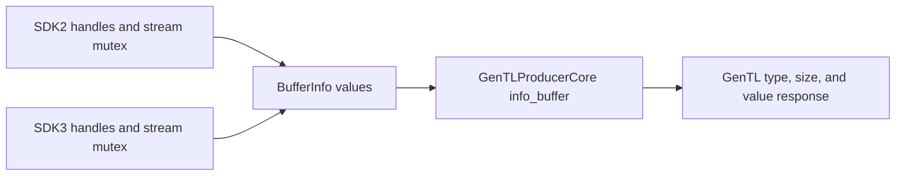

# Shared GenTL buffer information

## Scope and baseline

Extract the deterministic `DSGetBufferInfo` response dispatch shared by SDK2
and SDK3. Handle validation, stream locking, buffer ownership, frame metadata
capture, acquisition, and remote device controls stay with each producer.
the host application owns the SDK2 camera during this work: do not open it, rebuild the active
CTI, or modify any original checkout. Use isolated worktrees and builds.

| Repository | Source commit | Worktree / branch |
| --- | --- | --- |
| GenTLProducerCore | c038116 | core / refactor/shared-buffer-info |
| continuousSDK2GenTL | fd20b6e | sdk2 / refactor/shared-buffer-info |
| continuousSDK3GenTL | 05d33a6 | sdk3 / refactor/shared-buffer-info |

The review used separate worktrees with clean starting trees.

## Interface and ownership

A producer validates handles, acquires its existing stream mutex, and builds
an ephemeral `BufferInfo` value from its own buffer state. `info_buffer`
formats the response with the existing `info_scalar` / `info_string` helpers.
No SDK call, memory ownership, state transition, or lock lives in the shared
function. `tl_type` is a borrowed string valid for the call. No heap allocation
is introduced in the response path.

This diagram shows the boundary, not an acquisition data path:



Preserve existing differences explicitly: SDK2 DATA_SIZE is the captured
payload size, SDK3 DATA_SIZE is bytes filled. SDK2 IMAGEPRESENT is based on
bytes filled; SDK3 uses its existing new-data flag. Both TIMESTAMP forms keep
the producer's current timestamp representation. SDK3-only queries (delivered
image height, chunk layout ID, filename, larger-than-buffer and composite
flags) remain local; unsupported SDK2 commands remain unsupported. Common
constants describe these producers' contiguous little-endian PFNC images
without chunks. This API is not a universal multipart/chunk buffer model.

## Identifier preflight

Authority: EMVA GenTL 1.6 `DSGetBufferInfo`, `BUFFER_INFO_CMD`, and existing
core `info_scalar` / `info_string` conventions. Vendor headers are unchanged.

| Identifier | Layer / meaning | Source and decision |
| --- | --- | --- |
| BufferInfo | Protocol; values consumed by buffer information queries | GenTL BUFFER_INFO commands; ephemeral caller-supplied values, no lifecycle owner |
| info_buffer | Protocol; format a BUFFER_INFO response | Existing info_scalar/info_string naming; unknown commands return GC_ERR_NOT_IMPLEMENTED |
| base, size, user_ptr, timestamp, new_data, is_queued, is_acquiring, is_incomplete, tl_type, size_filled, width, height, x_offset, y_offset, x_padding, y_padding, frame_id, image_present, pixel_format, data_size | Protocol fields | Corresponding GenTL BUFFER_INFO command names; no renamed vendor controls |

No terminology checker exists in these repositories; audit changed identifiers
against the sources above. No new compatibility aliases or vocabulary authority
changes are needed.

## Delivery and validation

1. Add the shared value type, dispatch, and protocol tests. Test exact type,
   size, copied value, null output, undersized output, null arguments, unknown
   commands, nonzero offsets/padding, pointer/string responses, and independent
   image-present/new-data values.
2. Adopt in SDK2 and SDK3 without changing their state machines or supported
   query sets. Advance the core to 0.1.2 and require that version in package
   discovery. Source-checkout and installed-package builds must both work.
3. Run SDK2 mock conformance and XML tests in isolation. Run SDK3 simulator
   checks without discovering/opening the SDK2 camera. Record unavailable
   dependencies separately from test failures. No physical validation claim.
4. Independently review the shared dispatch, mappings, tests and ownership
   boundary. Record findings and final evidence before completion.

This is the metadata part of later extraction, not completion of all lifecycle
migration phases. Broader handle/event/stream extraction remains deferred.

## Status

The first extraction is implemented and independently reviewed. The reviewed changes are delivered on
`refactor/shared-buffer-info` branches; they are not merged or deployed. Original checkout branches and worktrees remain
unchanged; all edits and builds are in the isolated worktrees listed above.
No SDK2 camera operation or active CTI rebuild was performed.

| Configuration | Evidence / result |
| --- | --- |
| SDK2 baseline | 5 tests passed, mock SDK and XML only |
| SDK3 baseline | 3 tests passed, vendor simulator and GenApi-C/XML |
| Standalone core 0.1.2 | 2 tests passed |
| SDK2 + core source | 6 tests passed |
| SDK3 + core source | 4 tests passed, including added image/chunk/data-size assertions |
| SDK2 + installed core | 4 producer tests passed |
| SDK3 + installed core | 2 producer tests passed |
| Independent review | No blocking findings; reviewer independently built core and passed both tests |
| Runtime dependencies | readelf NEEDED entries contain vendor/system libraries, no shared core library |

Builds emitted no compiler warnings. Diffs pass `git diff --check`. These are
software/mock/simulator results, not physical camera or the host application validation. At this initial checkpoint no state machine or concurrency primitive changed.
The comprehensive corrective follow-up below adds register/queue coordination
and records its sanitizer evidence separately. The original SDK2 production
CTI remains at its pre-extraction path and timestamp.

### Verification environment and commands

For reproduction, point CMake at the SDK2 and SDK3 installations, the
EMVA GenTL 1.6 headers, and the GenApi 1.1 schema. SDK2 tests use the mock
configuration created by CMake. EMVA's
[2025.10 package](https://www.emva.org/standards-technology/genicam/genicam-downloads-archive/)
was downloaded to the isolated workspace and verified against its published
SHA-256 `632fed8c4092855354741261908ff0df0bf7a8ef6fedfa261ebec29a7998e8e6`.
The Linux64 x64 SDK/Runtime archives were extracted under
`deps/GenICam_Package_2025.10/Reference Implementation`, and the GenApi schema
archive under `GenApi`. Licensed dependencies are not committed or installed
system-wide. SDK3 uses GenApi-C 3.5.0 and SDK3 3.12.30012.0. The simulator
conformance test passed with exactly its two expected simulator devices.

From the isolated workspace, the main configurations are:

```sh
cmake -S core -B core/build \
  -DGenTLHeaders_ROOT=/path/to/gentl-1.6 \
  -DGenTLProducerCore_FETCH_GENTL_HEADERS=OFF
cmake --build core/build -j 6
ctest --test-dir core/build --output-on-failure
cmake --install core/build --prefix "$PWD/install"

cmake -S sdk2 -B sdk2/build \
  -DGENTL_PRODUCER_CORE_SOURCE_DIR="$PWD/core" \
  -DGenTLHeaders_ROOT=/path/to/gentl-1.6 \
  -DGenTLProducerCore_FETCH_GENTL_HEADERS=OFF \
  -Dcontinuous_SDK2_ROOT=/path/to/continuous-sdk2 \
  -Dcontinuous2_GENAPI_SCHEMA=/path/to/GenApiSchema_Version_1_1.xsd
cmake --build sdk2/build -j 6
ctest --test-dir sdk2/build --output-on-failure

cmake -S sdk3 -B sdk3/build \
  -DGENTL_PRODUCER_CORE_SOURCE_DIR="$PWD/core" \
  -Dcontinuous_SDK3_ROOT=/path/to/continuous-sdk3 \
  -DGENICAM_PACKAGE_ROOT="$PWD/deps/GenICam_Package_2025.10" \
  -DGenTLProducerCore_FETCH_GENTL_HEADERS=OFF \
  -DcontinuousSDK3_FETCH_GENICAM_HEADERS=OFF \
  -DcontinuousSDK3_REQUIRE_GENAPI_C_TEST=ON
cmake --build sdk3/build -j 6
ctest --test-dir sdk3/build --output-on-failure
```

For installed-package configurations, use a fresh `build-installed` directory,
omit `GENTL_PRODUCER_CORE_SOURCE_DIR`, and supply
`-DCMAKE_PREFIX_PATH="$PWD/install"`. Other arguments are the same. Baseline
SDK3 used the original, unmodified SDK3 source with an isolated build directory.

Full local logs are siblings of these worktrees: `core-*.log`,
`sdk2-baseline-*.log`, `sdk2-build.log`, `sdk2-tests.log`,
`sdk3-baseline-*.log`, `sdk3-build.log`, `sdk3-tests.log`,
`sdk2-installed-*.log`, and `sdk3-installed-*.log`.

### Review disposition and delivery order

The independent reviewer examined both adapter diffs and all core additions,
checked mappings against source baselines, and independently built and tested
the core in an independent build directory. No confirmed
finding required remediation. The producer test runs and installed-package
builds were verified by the primary agent. The review did not independently
repeat those integration runs or access hardware. No unresolved identifier or
compatibility-alias issue remains.

Commit/publish the core API first, then each producer adoption. Keep the core
requirement at 0.1.2 in both adapters so installed older packages fail at
configuration rather than compiling against a missing header. triggered and the
remaining handle/event/stream lifecycle migration are follow-up work.


## Comprehensive review follow-up

The initial extraction preserved behavior, but comprehensive review found
inherited protocol and memory-safety defects. [REVIEW.md](REVIEW.md) supersedes
this record's initial preservation decisions where the GenTL standard requires
correction: producer ownership flags, DATA_SIZE reset/intended-size behavior,
empty killed-image flags, and unknown-command errors. It also records the
port-helper corrections, publication/consumer concurrency work and future
callback-sdk boundary. Initial validation counts above describe the extraction
checkpoint, not the final corrective-review configuration.
