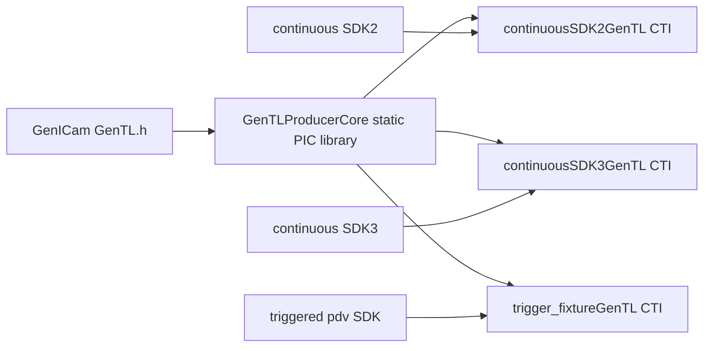

# GenTL producer-core migration

## Decision and boundary

The three GenTL producers remain separate private repositories. Each repository
builds against only the vendor SDK it needs. `GenTLProducerCore` is a separate
private repository and must remain SDK-free.

Phase 1 extracts deterministic, vendor-neutral port and information-transfer
code. It does not alter producer discovery, GenTL handle lifetime, event
delivery, streaming, buffer ownership, or remote-device feature maps.

This boundary allows every resulting `.cti` to statically link the common code
without requiring another shared object at deployment time.

The dependency boundary is:

Each producer owns its vendor adapter and links the core into its own CTI.
No producer build needs the other two vendor SDKs.

## Phase 1: stable extraction

Phase 1 owns the following API in namespace `gentl_producer_core`:

- `PortModel`, `PortDescriptor`, `PortUrlInfo`, and `XmlFileInfo`
- dynamic and data-backed register regions, including integer and string helpers
- embedded XML ports and file XML URLs
- CTI runtime location lookup using `dladdr`
- GenTL scalar and NUL-terminated string information transfer helpers

Phase-1 completion evidence is a C++20 PIC static library, a CMake install and
export package, and tests for register accesses, embedded XML reads, and GenTL
information buffer sizing/copying. The package requires an explicit
`GenTLHeaders_ROOT`; it must never bundle GenICam headers or vendor SDK assets.

## Producer adoption

Adopt one producer at a time.

1. Add `GenTLProducerCore` as a pinned source or development-package dependency.
2. Link `GenTLProducerCore::gentl_producer_core` into the producer CTI.
3. Replace its copied phase-1 definitions with includes from this package.
4. Keep producer-specific port assembly and XML assets in that producer.
5. Build its vendor-backed producer and run its existing GenTL conformance test.
6. Verify the CTI has no runtime dependency on a shared core library.

The first adoption should establish the exact integration convention and only
then be repeated in the other two repositories.

## Later lifecycle extraction

Lifecycle code is intentionally deferred because the producers do not share a
single buffer-ownership model. SDK2 and triggered use pull/copy acquisition, while
SDK3 queues consumer memory into its vendor SDK. A later extraction needs a
stable, explicitly designed boundary rather than a generic backend interface
that hides those differences.

| Later phase | Candidate common code | Acceptance gate |
| --- | --- | --- |
| 2 | GenTL handle validation and info dispatch scaffolding | Existing CTI conformance tests pass unchanged |
| 3 | Event reference/lifetime primitives | Event close, flush, and wait races have focused tests |
| 4 | Common TL/interface/device/stream ABI plumbing | Vendor-specific stream delivery remains outside core |
| 5 | Shared conformance harness | Every producer runs the same core cases plus its own hardware/mock cases |

Before Phase 2, document ownership, threading, and error behavior for each
candidate. Do not extract buffer-delivery control flow until both pull/copy and
directly queued-buffer paths have a tested, explicit strategy boundary.

## Risks and controls

- ABI drift: retain a C++20-only library API and run each producer's GenTL
  conformance test after adoption.
- Header ambiguity: require `GenTLHeaders_ROOT` during both build and package
  consumption.
- Accidental SDK coupling: the core build must not search vendor include or
  library paths.
- Premature lifecycle unification: defer lifecycle extraction until behavior
  and ownership contracts are specified and tested.
