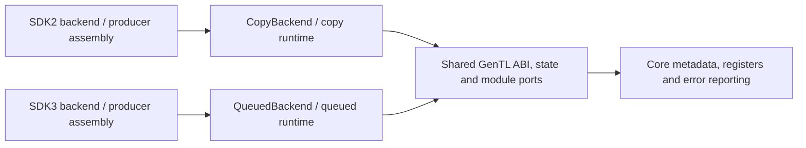

# Generic runtime and vendor backends

## Decision and scope

Move GenTL runtime implementation out of both producers into the SDK-free
shared core. Preserve the existing pull/copy and direct queued-memory ownership
models as explicit runtime targets and backend interfaces. Product identity,
module XML, backend creation and vendor policy belong to producer assembly and
the backend. No camera or the host application restriction applies to this task, but automated
validation uses SDK2 mocks and SDK3 simulator; physical qualification is distinct.

Worktrees are under `/path/to/workspace/worktrees/gentl-runtime-20261031`.
All three branches are `refactor/generic-runtime`; starting trees were clean.
Baselines: core `8469445`, SDK2 `795383c`, SDK3 `1e958c3`.

## Boundary and ownership

The runtime includes no continuous SDK headers, remote port implementation, product
macros, fixed product names, XML or vendor factory. `ProducerDefinition` supplies
version, CTI filename, module XML and a typed backend factory. Backend operations
supply camera discovery/controls and remote-write guards/feature invalidations.
`error.hpp` provides generic thread-local GenTL error reporting so vendor code
does not depend on runtime internals.

`CopyBackend` fills a caller-selected input buffer. `QueuedBackend` receives
consumer memory and returns its identity through queue/wait operations. The
runtime keeps the distinct state/ownership paths, stop behavior and reviewed
publication/consumption locking from each baseline. It does not replace direct
queueing with an extra copy, nor loan SDK2-owned circular-buffer memory.

Identical GenTL ABI definitions, runtime state operations and module assembly
have one shared source implementation, included by the selected ownership
translation unit. Model-specific workers, stream operations and lifecycle
bookkeeping stay in copy/queued implementation units. Each CTI links exactly
one static PIC runtime target. Private runtime symbols and assembly definitions
must remain local to the CTI, and internal GenTL calls bind to that CTI even
when a consumer uses RTLD_GLOBAL. GCInitLib anchors the ABI archive object so
a linker cannot discard unreferenced exported entry points.

## Interface preflight

Names follow GenTL buffer/producer terminology and existing backend contracts.
DeviceDescriptor, BackendInfo, StreamDescription, AcquireFrameStatus and
AcquireFrameResult move to the core; StreamDescription uses offset_x/offset_y
and padding bytes, and AcquireFrameResult carries buffer identity for queued
acquisition. CopyBackend and QueuedBackend name the two established ownership
contracts. ProducerDefinition and ModuleXml describe producer assembly data,
not a new lifecycle owner. set_last_error/last_error preserve GenTL's local
thread context. No camera feature/register names change. Vendor type aliases
are private migration boundaries, not new public camera concepts.

The additive runtime APIs require core 0.2.0. Producers depend on that version;
older installed core packages must fail configuration explicitly.

## Stream configuration updates, core 0.2.1

`ProducerBackend::remote_write_changes_stream_description(address, size)` opts
into a description refresh after successful idle remote writes. Its default
is false, so fixed-description producers incur no additional backend queries.
The name uses the existing remote-write operation and `StreamDescription`
contract. The backend owns register interpretation and feature access rules;
the runtime does not parse provider XML or identify geometry registers.

Each device's configuration mutex serializes remote writes and description
publication with host stream opening, start, stop and close. Lock order is
configuration, then stream/lifecycle, then backend. Workers do not acquire the
configuration mutex, so a host stop may join them while holding it. The runtime
tracks the single open stream directly and publishes refreshed description
fields under that stream's mutex. A failed description query prevents stream
opening without reserving the module.

Published buffers, including incomplete zero-byte buffers, retain their captured
image description. Unfilled buffers
report the current stream description, and queueing rejects a buffer smaller
than the current payload. `BufferInfo::delivered_image_height` maps the GenTL
`BUFFER_INFO_DELIVERED_IMAGEHEIGHT` query. Copy acquisition reports full height
only when delivered bytes cover the captured nonzero payload; a partial payload
reports zero because the backend does not identify complete rows. Queued
acquisition retains its existing delivered-height handling.

`StreamDescription::pixel_endianness` and `BufferInfo::pixel_endianness` use
GenTL's `PIXELENDIANNESS` values and default to `PIXELENDIANNESS_LITTLE`.
Backends can describe unknown byte order explicitly without a producer-specific
information-query override. The field follows the same snapshot rules as
pixel format. `AcquireFrameResult::frame_id_increment` lets copy backends
report the frame-sequence advance independently from the skipped-frame counter;
its default of one preserves contiguous numbering.

SDK-free synthetic tests exercise both ownership models: description failures,
idle-write publication through ABI and module registers, old-buffer snapshots,
unfilled geometry, opt-out query counts, payload validation, stop/join and a
controlled description/start versus remote-write interleaving. Formatter tests
also cover delivered height and unknown pixel endianness. Concurrent handle
destruction remains outside this change's lifetime guarantees.

## Implementation and acceptance

1. Move SDK-neutral descriptors/contracts and error reporting to core headers.
2. Move each ownership runtime, inject factory/XML/policy and remove src/core
   from both producer trees. Vendor sources retain only SDK work and policy.
3. Consolidate identical implementations; retain distinct ownership paths.
4. Verify core builds without either SDK; source-checkout and installed core
   work for both producers. Keep production CTIs free of test hooks.
5. Verify exported ABI parity and simultaneous loading/state isolation using
   SDK2 mock and SDK3 production simulator, including RTLD_GLOBAL.
6. Run existing mock/simulator/XML and deterministic publication/flush regressions,
   appropriate sanitizer checks and independent final review. Update producer
   documentation/traceability to the new implementation locations.

## Risks and verification limits

- C++ runtime-symbol or standard GenTL entry-point interposition between CTIs
  can silently select the wrong backend: inspect exports and exercise two CTIs
  in one process.
- Static archive dead stripping can omit the complete ABI: anchor the export
  object and compare exported functions against the baseline.
- Stop, timeout, kill and event ownership must preserve their model contracts;
  existing race regressions remain required.
- SDK3's known vendor simulator TSan reports reproduce on the unchanged baseline;
  do not suppress them to claim a clean sanitizer run.
- Concurrent destruction of handles during operations remains the documented
  later lifetime work; this extraction does not certify arbitrary Close races.

## Status

Implementation and software validation complete. Publication of the reviewed
changes is authorized on `refactor/generic-runtime`; no deployment was performed. Both producers' local
src/core directories are removed. There are 40 common ABI definitions, 15 common
Runtime operations, and one common module_ports.cpp. Remaining ownership-specific
state and entry points are compiled into the selected static runtime target.

| Check | Result |
| --- | --- |
| SDK-free standalone core | 5/5 tests passed |
| SDK2 source-checkout core | 9/9 tests passed |
| SDK3 source-checkout core | 9/9 tests passed, including native stop fault injection and production/instrumented simulator |
| SDK2 installed core | 4/4 producer tests passed |
| SDK3 installed core | 4/4 producer tests passed |
| Core ASan/UBSan | 5/5 passed with halt-on-UB |
| SDK2/shared runtime ThreadSanitizer | 8/8 native tests passed; Python schema test kept in normal configuration |
| Multi-CTI RTLD_GLOBAL | Both load orders pass independent initialization, identity, stacked read, error TLS and close/reinitialize checks |
| Production exported ABI | All 64 GenTL symbols preserved in each producer; test hooks absent |
| Dependency boundary | No vendor headers/identifiers in runtime code and no runtime includes in vendor backend code |
| Traceability | All moved implementation references resolve against local trees; prior evidence states/gaps retained |

Alignment regression fixtures implement a minimal SDK-free backend with 64-byte
requirements in both ownership models. They verify GenTL and XML metadata,
aligned allocation, requested-size reporting, overflow rejection, invalid
alignment rejection, consumer-address validation and Start revalidation after
requirements change. The SDK2 backend explicitly reports its existing uint16
alignment; the SDK3 backend explicitly reports its existing eight-byte alignment.
A reverted-validation variant failed before correction. No mock vendor capability
was invented to force that test.

### Independent review

| Finding | Disposition |
| --- | --- |
| RUNTIME-R1: installed consumers lacked test runtime targets | Fixed: instrumented SDK-free development archives are installed/exported; both installed configurations pass |
| RUNTIME-R2: vendor transfer alignment selected by ownership model | Fixed: backend StreamDescription.buffer_alignment drives validation, allocation and metadata; both model fixtures pass |
| RUNTIME-R3: implicit queue/stop/wait contracts | Documented explicitly in backend.hpp, including FIFO identity, storage lifetime, concurrent stop/wait and explicit buffer retirement |
| RUNTIME-R4: identical port ABI implementations duplicated | Fixed: seven more functions joined exports_common.inc; all module ports consolidated into one source |
| RUNTIME-R5: native buffers may be reclaimed after failed native stop | Fixed: explicit retirement result, retained ownership/handles on failure and explicit retry; core and native fault injection pass |

Independent final source/ELF review found no new blocking regression. Private
producer definitions, Runtime singletons and error state are local ELF symbols;
-Bsymbolic-functions prevents internal GenTL call interposition and
--undefined=GCInitLib retains ABI code from the static archive. The simultaneous
loading test independently verifies those behaviors.

RUNTIME-R5 now separates operational stop success from affirmative return of
borrowed buffers. Failed retirement preserves memory, queue flags and handles
until an explicit retry succeeds. SDK3 retains its native FIFO after failed
AT_Flush. Existing graceful DEFAULT and interrupting KILL behavior is preserved;
the unchanged simulator tests pass. See [failed-stop ownership](FAILED_STOP_OWNERSHIP.md)
for fault coverage, independent review and frame-path constraints. Source-handle
Close races remain separate lifetime work. Software injection does not establish
physical-camera behavior under native SDK failures.

### Reproduction and evidence

Worktree commands use the new core source directory for source builds; installed
builds omit that override and set CMAKE_PREFIX_PATH to the isolated install prefix.
Headers: original SDK2 build/_deps/gentl-1.6. SDK2 root:
/path/to/continuous-sdk2. SDK3 root:
/path/to/continuous-sdk3. GenApi package:
/path/to/workspace/worktrees/gentl-buffer-info-20261031/deps/GenICam_Package_2025.10. Vendor files are read-only dependencies, never copied into
or committed with the core. SDK3 test PATH includes /usr/sbin:/sbin for its
vendor ldconfig invocation. The SDK3 vendor libatcore ELF .dynsym diagnostics
remain unchanged; no new compiler warnings were observed.

Logs are alongside these worktrees: core-{configure,build,tests,install}.log,
sdk{2,3}-final-{build,tests}.log, sdk{2,3}-installed-{configure,build,tests}.log,
asan-{configure,build,tests}.log and isolation{,-reverse}.log. Source SDK3 build
is sdk3-build; source SDK2 build is sdk2/build. runtime_isolation.py takes copy
and queued CTI paths explicitly and initializes libraries without opening a
camera. Use the SDK2 mock CTI and SDK3 simulator CTI for that check. Isolation logs
were recorded in both load orders; final post-factoring checks are recorded as
isolation-final{,-reverse}.log.

Final R5 logs use the `r5-final-` prefix: core, SDK2/SDK3 source and installed
build/test logs, ASan/UBSan, SDK2 TSan and isolation in both load orders. These
supersede the earlier R5 draft results.

Requirement IDs and evidence classifications are preserved. Cross-repository
implementation links refer to the shared core feature branch
`refactor/generic-runtime`, published before the producer branches. No physical camera qualification was performed. The previous
SDK3 vendor simulator TSan warnings remain a vendor qualification boundary; this
extraction does not claim a clean SDK3 TSan result.
